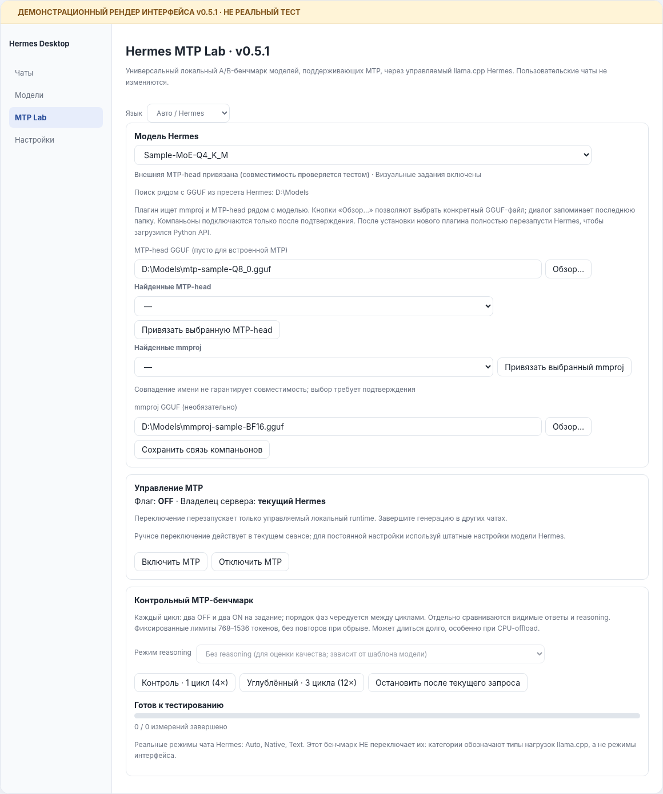

# Hermes MTP Lab

**v0.3.0 · Automatic MTP A/B benchmark for Hermes Desktop · MIT · Experimental**

*Скриншот реального теста на Hermes Desktop. / Real Hermes Desktop screenshot.*

**Навигация / Navigation / 导航 / नेविगेशन:** [Русский](#ru) · [English](#en) · [简体中文](#zh) · [हिन्दी](#hi) · [Конец / End](#end)

---

## 🇷🇺 Русский

**Hermes MTP Lab** — независимый плагин для Hermes Desktop, позволяющий включать и выключать MTP (Multi-Token Prediction) у выбранной локальной модели, совместимой с MTP и автоматически сравнивать скорость генерации с MTP и без него. Отправлять промпты вручную не нужно: задания, тестовая фотография, прогрев и повторные проходы входят в пакет. Плагин обращается к управляемому локальному `llama.cpp`, не изменяет пользовательские переписки и не требует платного облачного API.

### Возможности

- Страница **MTP Lab** в левом меню и в настройках плагинов Hermes; кнопки MTP ON/OFF.
- **Русский и английский интерфейс:** язык можно выбрать вручную (`Русский` / `English`) или автоматически следовать языку Hermes. Выбор сохраняется локально. Переведены подписи, статусы, подсказки, предупреждения и сообщения интерфейса; диагностические ошибки ядра могут оставаться на языке оригинала.
- **Быстрый тест:** 8 измерений для текстовой модели или 12 для модели с mmproj. **Полный тест:** 24 или 36 измерений соответственно.
- Текст, Python-код, вычисления, повествование, описание изображения, распознавание надписей и пространственных связей. Оригинальная тестовая картинка включена в архив.
- Отображение загрузки модели, прогрева, этапа генерации, времени всего теста и текущего этапа, реальных токенов при наличии серверных метрик. Неизвестный процент загрузки **не выдумывается**.
- Скорость декодирования, MTP draft/accepted, проверка параметров фаз, отчёты `summary.md`, `results.csv`, `results.json`.
- Побайтовое восстановление исходного нативного preset после теста; резервные копии и восстановление при прерывании.

**Важно:** в Hermes существуют режимы чата **Auto, Native, Text**. Названия групп MTP Lab — это **типы серверной нагрузки**, а не режимы чата. Плагин проводит запросы напрямую через локальный `llama.cpp`; он **не** измеряет задержку UI, время до первого токена или полный цикл работы Auto/Native/Text. Если параметры OFF и ON нельзя подтвердить одинаковыми, ускорение считается **наблюдаемым**, а не строго приписываемым MTP.

### Совместимость

Плагин **не привязан к архитектуре, квантизации или имени модели**. Модель выбирается из управляемых пресетов Hermes, а совместимые компаньоны `mtp_head` и `mmproj` можно указать отдельно для неё. Поддерживаются текстовые модели без mmproj, модели с отдельной MTP-head и модели со встроенным MTP, обнаруженным в GGUF-метаданных или нативном пресете. **Это не означает, что любая LLM умеет MTP:** необходимы совместимость модели, head, `llama.cpp` и доступная память. При отсутствии подтверждённой MTP-конфигурации запуск запрещён. GGUF-файлы в пакет не входят.

### Установка из GitHub Release на Windows

1. Скачайте **`Hermes_MTP_Lab_v0.3.0_PORTABLE_INSTALL.zip`** в [Releases](https://github.com/SergPoletaev/Hermes-MTP-Lab/releases) и **полностью распакуйте** в любую папку.
2. Полностью завершите Hermes Desktop, включая значок в трее.
3. Дважды щёлкните `Install-Hermes-MTP-Lab.cmd`. Установщик копирует папку плагина, сохраняет резервную копию предыдущей версии и вызывает штатную команду `hermes plugins enable hermes-mtp-lab` для разрешения Python-бэкенда. Он не правит произвольный YAML вручную.
4. Запустите Hermes; в **Возможности → Plugins** включите Desktop-компонент `MTP Lab`, если он отключён.
5. Откройте **MTP Lab** слева и выберите язык справа вверху: `Авто / Hermes`, `Русский` или `English`.
6. Убедитесь, что Python API подключён, а текущий Hermes владеет локальным сервером. Выберите модель из списка, проверьте наличие совместимого MTP GGUF и необязательного mmproj, затем запустите быстрый тест без других параллельных запросов.

Файлы результатов сохраняются в `Рабочий стол\Hermes-MTP-Reports\run-YYYYMMDD-HHMMSS\` (при отсутствии Desktop — в домашнем каталоге). Временный контекст OFF/ON одинаков и не превышает **32768 токенов** либо исходное окно, если оно меньше. После теста исходный preset восстанавливается побайтово. В отчёты не включаются ответы модели, ваши чаты, изображения пользователя и API-ключи; сохраняются хеши ответов. При ошибке восстановления сначала используйте предусмотренную кнопку восстановления.

### Проверки и статус

Версия **v0.2.1** уже проходила реальные 12- и 36-измерительные тесты на Windows Hermes: на этой конфигурации наблюдалось ускорение порядка 2,5×, но часть эффективных параметров сервера не была подтверждена идентичной. **v0.3.0 остаётся экспериментальной**: новый выбор моделей и обновлённый интерфейс проверены только автоматическими тестами, но требуют проверки в установленном Hermes. CI выполняет только офлайн-тесты без GPU и не доказывает работу в приложении.

Разработка: `python -m unittest discover -s hermes-mtp-lab/tests -p "test_*.py" -v`, `node hermes-mtp-lab/tests/test_desktop_registration.cjs`, `python tools/verify_repo.py`. См. [методику](docs/BENCHMARK_METHODOLOGY.md), [архитектуру](docs/ARCHITECTURE.md), [пример результатов](docs/EXAMPLE_RESULTS_2026-11-15.md), [историю изменений](CHANGELOG.md) и [политику безопасности](SECURITY.md).

Проект независимый, неофициальный, разработан для [NousResearch Hermes Agent](https://github.com/NousResearch/hermes-agent), не является форком ChatVault и распространяется по [MIT](LICENSE). На компоненты Hermes и веса моделей распространяются их собственные лицензии.

[↑ К началу](#top) · [English →](#en) · [简体中文 →](#zh) · [हिन्दी →](#hi)

---

## 🇬🇧 English

**Hermes MTP Lab** is an independent Hermes Desktop plugin for enabling/disabling Multi-Token Prediction (MTP) on a selected MTP-capable locally managed GGUF model and automatically benchmarking decoding throughput with MTP OFF versus ON. All prompts, an original test image, warmups and repetitions are included. Requests run through the Hermes-managed local `llama.cpp` server, not through paid cloud APIs, and do not change your conversations.

### Features

- A dedicated **MTP Lab** sidebar/settings page with MTP ON/OFF controls.
- **English and Russian UI**, with a persistent manual language selector (`English`, `Русский`) or **Auto / Hermes** locale detection. UI labels, stages, warnings, help text and status messages are bilingual. Low-level diagnostic errors may remain in the backend's original language.
- **Quick benchmark:** 8 text-only measurements or 12 with a vision projector. **Full benchmark:** 24 or 36 measurements, respectively.
- Explanation, Python programming, calculations, narrative writing, image description, visible text and object grounding. Includes the same original reference JPEG for both phases.
- Live model-load and warmup stages, per-stage and overall timers, factual token counters when available, and indeterminate indicators instead of invented percentages.
- Server-side decode tok/s, MTP draft acceptance, configuration comparability checks, and Markdown/CSV/JSON reports.
- Restores the exact original Hermes managed preset bytes after the run; backup and recovery safeguards for interruptions.

**Scope:** Hermes chat offers **Auto, Native and Text** modes. MTP Lab workload categories are **not** these chat modes. The tests call local `llama.cpp` directly and do **not** benchmark the complete chat UX, desktop rendering or time to first token. If effective OFF/ON settings cannot be verified identical, reported speedup is *observational*, not a controlled estimate of MTP alone.

### Compatibility

The plugin has **no model-family, quantization or fixed-name restriction**. Select a Hermes-managed preset; explicitly link its compatible `mtp_head` and optional `mmproj`, or use embedded MTP when advertised by GGUF metadata/native preset. Text-only models do not need a projector. **Not every LLM supports MTP**: a compatible model/head, llama.cpp build and sufficient memory are required. Unsupported models are refused, not silently benchmarked as MTP. No GGUF weights or Hermes/llama.cpp binaries are shipped.

### Windows installation from a GitHub release

1. Download `Hermes_MTP_Lab_v0.3.0_PORTABLE_INSTALL.zip` from [Releases](https://github.com/SergPoletaev/Hermes-MTP-Lab/releases) and extract it fully to any folder.
2. Fully **Quit Hermes**, including its tray process.
3. Double-click `Install-Hermes-MTP-Lab.cmd`. It backs up the previous plugin, installs the package and uses the official `hermes plugins enable hermes-mtp-lab` command for the Python backend. It does not edit arbitrary YAML using text substitutions.
4. Open Hermes → **Capabilities → Plugins** and enable the MTP Lab Desktop card if necessary.
5. Open **MTP Lab** in the sidebar, select **Auto / Hermes**, **English** or **Русский**, and confirm that the Python backend owns the managed local server.
6. Select the model and verify its MTP companion and optional mmproj, then run Quick test without other chats generating.

Sanitized reports are written to `Desktop/Hermes-MTP-Reports/run-YYYYMMDD-HHMMSS/`, or under your home directory when Desktop is unavailable. The test uses the same `ctx-size` in both phases, no larger than **32768** or the existing native window, and restores the original preset bytes afterwards. Reports store output hashes, but never model replies, user chats, private user images or API keys.

### Validation and release status

v0.2.1 was tested in live Windows Hermes sessions with both 12 and 36 measured requests, showing about 2.5× *observed* speedup on that particular machine; not all effective settings could be independently verified. **v0.3.0 is experimental:** the generic model-selection backend and bilingual UI passed local automated checks but still need real Desktop validation. Green CI does not imply successful GPU/Desktop integration.

Developer commands: `python -m unittest discover -s hermes-mtp-lab/tests -p "test_*.py" -v`, `node hermes-mtp-lab/tests/test_desktop_registration.cjs`, `python tools/verify_repo.py`. See [methodology](docs/BENCHMARK_METHODOLOGY.md), [architecture](docs/ARCHITECTURE.md), [example results](docs/EXAMPLE_RESULTS_2026-11-15.md), [changelog](CHANGELOG.md) and [security](SECURITY.md).

This is an independent, unofficial community plugin for [NousResearch Hermes Agent](https://github.com/NousResearch/hermes-agent), not a ChatVault fork. Its own code is [MIT licensed](LICENSE); Hermes and model components retain their respective licenses.

[↑ Top](#top) · [Русский →](#ru) · [简体中文 →](#zh) · [हिन्दी →](#hi)

---

## 🇨🇳 简体中文

**Hermes MTP Lab** 是面向 Hermes Desktop 的独立插件，用于控制所选、支持 MTP 的本地 GGUF 模型的多令牌预测（MTP，Multi-Token Prediction），并自动比较 MTP 关闭与开启时的生成速度。测试提示词、参考图片、预热和重复测试都已经包含在安装包中。测试通过 Hermes 管理的本地 `llama.cpp` 服务器运行，不需要付费云端 API，也不会修改用户聊天记录。

### 主要功能

- Hermes 左侧导航栏与插件设置中的独立 **MTP Lab** 页面，支持开启和关闭 MTP。
- **俄语／英语双语界面**：手动选择 `Русский` 或 `English`，或者使用 `Auto / Hermes` 自动跟随 Hermes 的语言；选择会保存在本地。按钮、状态、警告和说明均有翻译；底层诊断错误可能仍保留原始语言。
- **快速测试**：纯文本模型为 8 次测量，带视觉投影器为 12 次；**完整测试**：分别为 24 或 36 次测量。
- 包含技术说明、Python 编程、计算、叙事写作、图像描述、文字识别和物体位置分析；两种状态使用同一张原创建议测试图片。
- 显示模型加载、预热、生成阶段、总用时及阶段用时；只有服务器提供真实数据时才显示令牌计数，不伪造加载百分比。
- 记录解码速度（token/s）、MTP 草稿令牌接受情况、配置一致性及 Markdown/CSV/JSON 报告。
- 测试完成后逐字节恢复原始 Hermes 预设；提供备份与异常恢复。

**重要说明：** Hermes 的聊天模式是 **Auto、Native、Text**；MTP Lab 的任务分类**不是**聊天模式。测试直接访问本地 `llama.cpp`，不测量桌面界面延迟或首令牌时间。若无法确认 OFF/ON 的其他参数一致，加速结果只应视为*观察值*，不能完全归因于 MTP。

### 兼容性

本插件**不绑定特定模型、量化版本或架构名称**。可从 Hermes 管理的模型预设中选择模型，明确指定兼容的 MTP-head GGUF 和可选 mmproj；也支持 GGUF 元数据或原生预设确认的内置 MTP。纯文本模型不需要 mmproj。**并非所有 LLM 都支持 MTP**：必须验证模型、辅助文件、llama.cpp 及可用内存的兼容性；不支持时拒绝运行。安装包不包含模型权重。

### Windows 安装

1. 从 [Releases](https://github.com/SergPoletaev/Hermes-MTP-Lab/releases) 下载 `Hermes_MTP_Lab_v0.3.0_PORTABLE_INSTALL.zip`，完整解压到任意文件夹。
2. 完全退出 Hermes，包括系统托盘中的程序。
3. 双击 `Install-Hermes-MTP-Lab.cmd`。安装程序备份旧插件，并调用 Hermes 官方命令 `hermes plugins enable hermes-mtp-lab` 启用 Python 后端，而不会直接修改 YAML 文本。
4. 启动 Hermes，在 **Capabilities → Plugins** 中按需启用 MTP Lab Desktop 插件。
5. 从左侧打开 **MTP Lab**，在页面右上角选择 `Auto / Hermes`、`Русский` 或 `English`。确认 Python 后端和服务器所有权检查通过。
6. 先选择模型及其 MTP 配置、可选 mmproj，确保其他聊天不在生成，再运行 **Quick test**，之后再运行完整测试。

结果保存在 `Desktop/Hermes-MTP-Reports/run-YYYYMMDD-HHMMSS/` 中，若没有 Desktop 则使用用户主目录。测试两种状态使用相同的上下文，不超过 **32768** 或原始窗口值，之后逐字节恢复原始预设。报告只保存模型输出的哈希，不保存实际回复、私人聊天、用户图片或 API 密钥。

### 验证与许可

v0.2.1 已在 Windows Hermes 中完成 12 次及 36 次测量，特定设备上观察到约 2.5 倍的速度提升；但部分有效参数未能确认完全一致。**v0.3.0 仍属实验版本**：双语界面及发布包通过了本地自动化测试，尚需真实 Hermes Desktop 验证。CI 通过不等于真实 GPU 测试通过。

开发与详情：`python -m unittest discover -s hermes-mtp-lab/tests -p "test_*.py" -v`、`node hermes-mtp-lab/tests/test_desktop_registration.cjs`、`python tools/verify_repo.py`；参阅[测试方法](docs/BENCHMARK_METHODOLOGY.md)、[架构](docs/ARCHITECTURE.md)、[示例结果](docs/EXAMPLE_RESULTS_2026-11-15.md)、[更新历史](CHANGELOG.md)和[安全政策](SECURITY.md)。

本项目是面向 [NousResearch Hermes Agent](https://github.com/NousResearch/hermes-agent) 的非官方独立插件，并非 ChatVault 的分叉项目。插件自有代码使用 [MIT 许可证](LICENSE)，模型和 Hermes 组件遵循其各自的许可证。

[↑ 返回顶部](#top) · [Русский →](#ru) · [English →](#en) · [हिन्दी →](#hi)

---

## 🇮🇳 हिन्दी

**Hermes MTP Lab** Hermes Desktop के लिए एक स्वतंत्र प्लगइन है। यह चयनित MTP-संगत स्थानीय GGUF मॉडल पर Multi-Token Prediction (MTP) को चालू या बंद करता है और MTP OFF तथा ON के बीच जनरेशन की गति की स्वचालित तुलना करता है। सभी परीक्षण प्रॉम्प्ट, संदर्भ चित्र, वॉर्म-अप और पुनरावृत्तियाँ पैकेज में शामिल हैं। परीक्षण Hermes द्वारा संचालित स्थानीय `llama.cpp` सर्वर का उपयोग करते हैं; किसी सशुल्क क्लाउड API की ज़रूरत नहीं होती और मौजूदा चैट बदली नहीं जाती।

### सुविधाएँ

- Hermes की बाईं ओर **MTP Lab** पेज और प्लगइन सेटिंग्स में MTP ON/OFF बटन।
- **रूसी और अंग्रेज़ी इंटरफ़ेस**: `Русский`, `English` या `Auto / Hermes` चुनें। चयन स्थानीय रूप से सुरक्षित रहता है; बटन, स्थिति, चेतावनियाँ और सहायता संदेश अनूदित हैं। निम्न-स्तरीय तकनीकी त्रुटियाँ मूल भाषा में रह सकती हैं।
- **त्वरित परीक्षण:** टेक्स्ट-ओनली मॉडल के लिए 8 या mmproj वाले मॉडल के लिए 12 माप। **पूर्ण परीक्षण:** क्रमशः 24 या 36 माप।
- तकनीकी व्याख्या, Python कोड, गणना, कहानी, तस्वीर का वर्णन, लिखे हुए शब्दों की पहचान और वस्तुओं के स्थान का विश्लेषण। दोनों अवस्थाओं में एक ही मूल परीक्षण JPEG इस्तेमाल होता है।
- मॉडल लोडिंग, वॉर्म-अप, जनरेशन, कुल समय और वर्तमान चरण का समय दिखाता है। वास्तविक सर्वर आँकड़े उपलब्ध होने पर ही टोकन काउंटर दिखता है; मनगढ़ंत प्रतिशत नहीं दिखाए जाते।
- टोकन/सेकंड, MTP के ड्राफ़्ट तथा स्वीकृत टोकन, OFF/ON कॉन्फ़िगरेशन की तुलना और Markdown/CSV/JSON रिपोर्ट।
- परीक्षण के बाद मूल Hermes प्रीसेट को बाइट-दर-बाइट बहाल करता है; बैकअप और रुकावट के बाद रिकवरी की सुविधा।

**ध्यान दें:** Hermes में चैट मोड **Auto, Native और Text** हैं। MTP Lab के कार्य समूह इन मोडों के समान **नहीं** हैं। परीक्षण सीधे स्थानीय `llama.cpp` को भेजे जाते हैं और यूज़र इंटरफ़ेस का विलंब या पहले टोकन का समय नहीं मापते। यदि OFF/ON के अन्य पैरामीटर समान होने की पुष्टि न हो, तो दिखाई गई तेज़ी केवल *देखी गई गति* है, केवल MTP का प्रमाण नहीं।

### संगतता

यह प्लगइन **किसी विशेष मॉडल नाम, क्वांटाइज़ेशन या आर्किटेक्चर तक सीमित नहीं है**। Hermes के प्रबंधित प्रीसेट में से मॉडल चुनें और उसके संगत MTP-head तथा वैकल्पिक mmproj को स्पष्ट रूप से लिंक करें। GGUF मेटाडेटा या मूल प्रीसेट में दर्ज एम्बेडेड MTP भी समर्थित है। टेक्स्ट-ओनली मॉडल के लिए mmproj आवश्यक नहीं है। **हर LLM में MTP नहीं होता**; मॉडल, head, llama.cpp तथा मेमोरी संगत होने चाहिए। असंगत मॉडल पर परीक्षण शुरू नहीं होगा। GGUF वेट्स शामिल नहीं हैं।

### Windows पर स्थापना

1. [Releases](https://github.com/SergPoletaev/Hermes-MTP-Lab/releases) से `Hermes_MTP_Lab_v0.3.0_PORTABLE_INSTALL.zip` डाउनलोड करके पूरा संग्रह किसी भी फ़ोल्डर में निकालें।
2. सिस्टम ट्रे सहित Hermes Desktop को पूरी तरह बंद करें।
3. `Install-Hermes-MTP-Lab.cmd` पर डबल-क्लिक करें। इंस्टॉलर पुराने प्लगइन का बैकअप बनाता है और Python बैकएंड के लिए आधिकारिक `hermes plugins enable hermes-mtp-lab` कमांड चलाता है। यह मनमाने YAML टेक्स्ट को संपादित नहीं करता।
4. Hermes खोलें और आवश्यकता होने पर **Capabilities → Plugins** में MTP Lab Desktop कार्ड सक्षम करें।
5. बाईं ओर **MTP Lab** खोलें और ऊपर दाईं तरफ `Auto / Hermes`, `Русский` या `English` चुनें। Python बैकएंड तथा सर्वर स्वामित्व की पुष्टि करें।
6. मॉडल और संगत MTP/वैकल्पिक mmproj चुनें, दूसरी चैट में जनरेशन बंद रखते हुए पहले **Quick test**, फिर पूरा परीक्षण चलाएँ।

परिणाम `Desktop/Hermes-MTP-Reports/run-YYYYMMDD-HHMMSS/` में सुरक्षित होते हैं; Desktop उपलब्ध न होने पर होम डायरेक्टरी का उपयोग होता है। दोनों अवस्थाओं में समान कॉन्टेक्स्ट रखा जाता है, **32768 टोकन** या मूल छोटी सीमा से अधिक नहीं; इसके बाद प्रीसेट के मूल बाइट बहाल किए जाते हैं। रिपोर्ट में आउटपुट के हैश रहते हैं, पर निजी चैट, मॉडल के उत्तर, व्यक्तिगत चित्र या API कुंजियाँ नहीं रहतीं।

### परीक्षण एवं लाइसेंस

v0.2.1 का Windows Hermes में 12 और 36 मापों के साथ वास्तविक परीक्षण हुआ था, जिसमें उस सिस्टम पर लगभग 2.5 गुना *देखी गई* तेज़ी मिली। कुछ सर्वर पैरामीटर पूरी तरह समान होने की पुष्टि नहीं हुई। **v0.3.0 प्रयोगात्मक है**: द्विभाषी इंटरफ़ेस और पैकेजिंग की स्थानीय स्वचालित जाँच सफल हुई है, लेकिन वास्तविक Hermes Desktop पर अलग परीक्षण आवश्यक है। CI की सफलता वास्तविक GPU जाँच नहीं है।

डेवलपर जाँच: `python -m unittest discover -s hermes-mtp-lab/tests -p "test_*.py" -v`, `node hermes-mtp-lab/tests/test_desktop_registration.cjs`, `python tools/verify_repo.py`। [परीक्षण पद्धति](docs/BENCHMARK_METHODOLOGY.md), [आर्किटेक्चर](docs/ARCHITECTURE.md), [उदाहरण परिणाम](docs/EXAMPLE_RESULTS_2026-11-15.md), [बदलाव का इतिहास](CHANGELOG.md) और [सुरक्षा नीति](SECURITY.md) देखें।

यह [NousResearch Hermes Agent](https://github.com/NousResearch/hermes-agent) के लिए एक स्वतंत्र, गैर-आधिकारिक प्लगइन है, ChatVault का फ़ोर्क नहीं। प्लगइन के अपने कोड का लाइसेंस [MIT](LICENSE) है; Hermes और मॉडल घटकों के लाइसेंस अलग हैं।

[↑ ऊपर जाएँ](#top) · [Русский →](#ru) · [English →](#en) · [简体中文 →](#zh)

---

**Hermes MTP Lab · v0.3.0 · [↑ Back to top / К началу](#top)**
